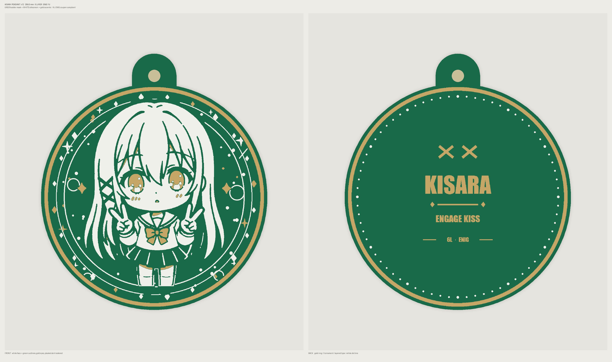
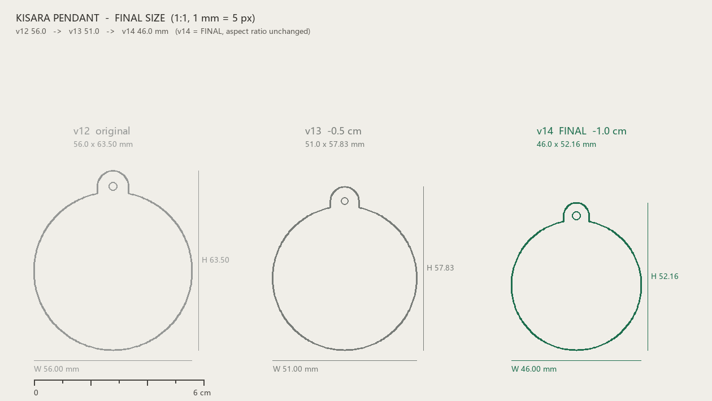

# 木更 6 层沉金 PCB 挂件

《契约之吻》木更（Kisara）主题的双面 PCB 钥匙挂件。真 6 层沉金，圆形 Φ46 mm + 同心挂耳，绿油白字。正面为 Q 版全身像，背面为金环与角色名。生产文件可直接交付嘉立创打样。





## 规格

| 项目 | 参数 |
|---|---|
| 成品尺寸 | 46.0 × 52.16 mm（Φ46 圆 + 挂耳） |
| 层数 | 6（六个铜层均有差异化图形，无空白假层） |
| 板厚 / 板材 | 1.6 mm / FR-4 常规（TG135） |
| 阻焊 / 字符 | 绿色 / 白色 |
| 表面处理 | 沉金 ENIG 1U" |
| 挂孔 | Φ3.0 mm，NPTH |
| 沉金面积 | 18.4%（低于 20% 上限） |
| 最小丝印线宽 | 0.164 mm（Gerber 回读 @64 ppm） |
| 数量 / 出货 | 5 片 / 单片 |

## 设计与工艺要点

正面用白丝印块面表现脸、水手服和袜子，绿色阻焊留白做勾线；金瞳、发饰、装饰环与背面的 `KISARA` 字样由沉金开窗实现。六个铜层分别布有同心环、放射线、菱形串等不同真实图形。

顶底层铜箔挖空必须避开两面沉金开窗——沉金只镀在铜上，开窗下方没铜会镀不上。出图走位图分区：三色版画稿按白／黑／品红直接分区，不对人物做矢量化描线；装饰先画整圆，再用人物实体掩膜裁掉压到角色的部分。白丝印细线经圆盘开运算清理，线宽 P5 达标。

## 文件结构

```
README.md                                  本说明
build/Kisara_Pendant_6L_ENIG_v14_HOLE3.zip  最终生产包，12 个文件
build/gerber14/                             解压后的 12 层源文件（GTL/G1~G4/GBL/GTS/GBS/GTO/GBO/GKO/TXT）
build/README_v14.md                         最终版自检、下单参数核对表
build/README_v13.md                         51 mm 备选版说明
build/README_v12.md                         EDA 导入、层压顺序、券条件逐条核对（最详细）
scripts/                                    设计、出图与自检脚本
assets/final_v12.png                        正面效果图
assets/size_final_v14.png                   三版尺寸对比
assets/v12_copper_layers.png                六个内层铜图形预览
```

核心脚本链路：`design12.py` → `make_release12.py` → `final12.py` 生成 56 mm 原版；`scale13.py` 做坐标仿射缩放，`check13.py` 回读自检，`final14.py` 一次生成 46 mm 版及全部核对结果。其余为迭代过程脚本。

## 下单要点

嘉立创 6 层沉金 EDA 专用券对应参数：6 层 / 1.6 mm / FR-4 常规 / 绿阻焊 / 白字符 / 沉金 1U" / 5 片 / 单片 / 无阻抗。层压顺序选「指定层压顺序」，六行为 `L1 GTL → L2 G1 → L3 G2 → L4 G3 → L5 G4 → L6 GBL`。阻焊覆盖选「过孔塞树脂 + 过孔电镀盖帽」，不能选「过孔盖油」。完整核对表见 `build/README_v14.md`，EDA 工程导入步骤见 `build/README_v12.md`。

挂孔是机械 NPTH，不随板子等比缩放——缩放只改坐标与孔径比例，挂孔按 Φ3.0 保留。下单页「板子尺寸」框由 GKO 自动解析，不要手改。

## 复现

环境为 Python 3，依赖 `numpy` 与 `Pillow`，从 `scripts/` 目录运行。原始线稿与参考图因涉及第三方素材未纳入本仓库，直接重跑图像链路需自行准备输入；已有 Gerber 和 zip 不依赖这些素材。

## 版权

木更（Kisara）及《契约之吻》相关角色形象、官方设定图与周边商品图的权利归原作者及版权方所有。本项目是个人非商业的 PCB 工艺与排版练习，效果图仅作制程结果展示，不构成角色形象的授权。脚本代码可自由参考与修改；角色形象与效果图不在该授权范围内，不得商用或声称对其拥有权利。
