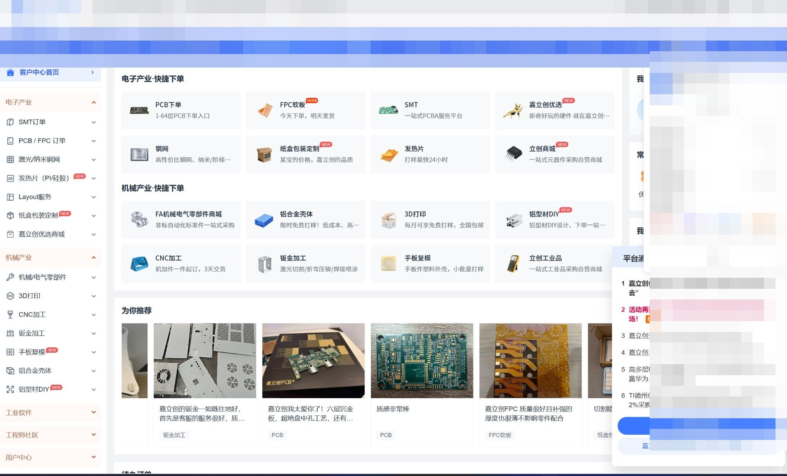
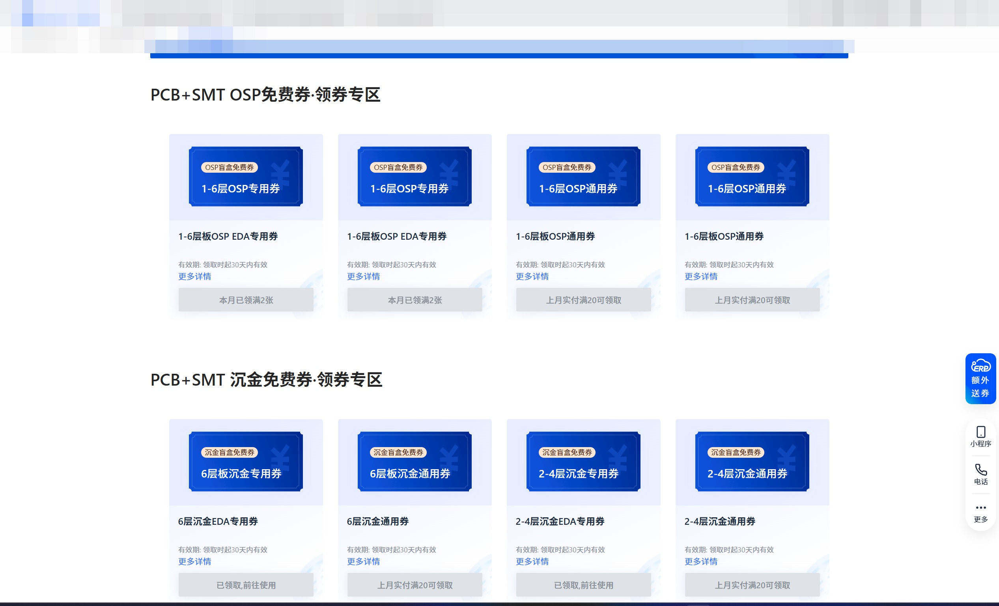
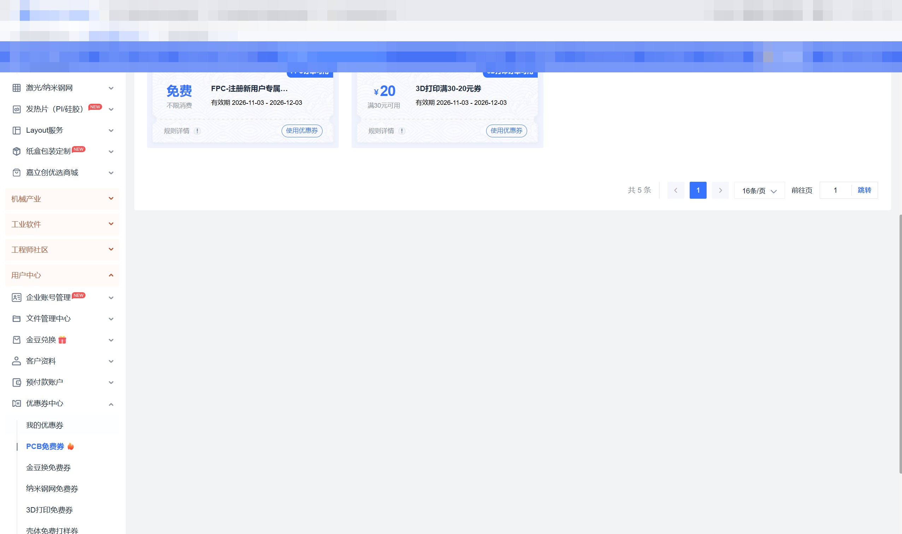
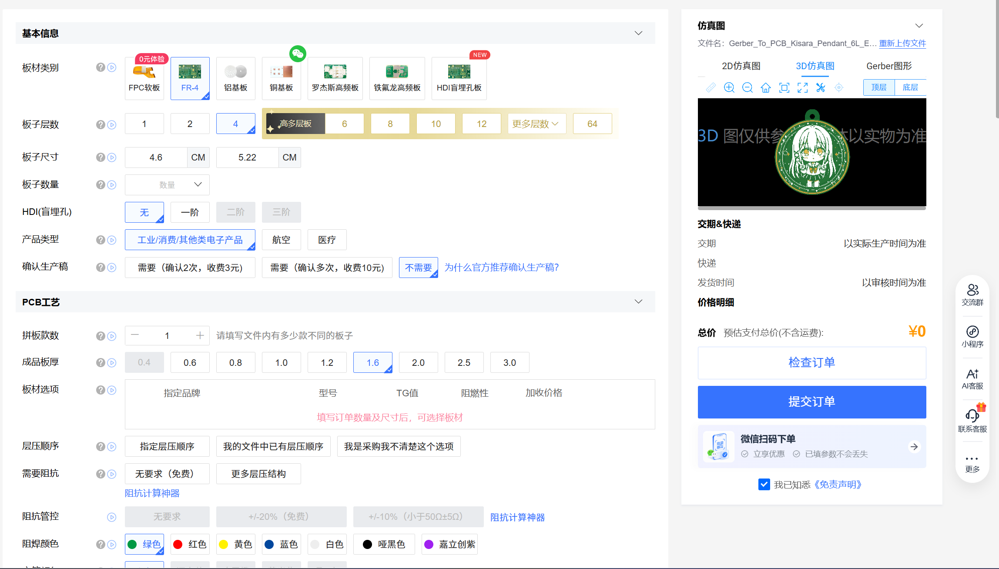
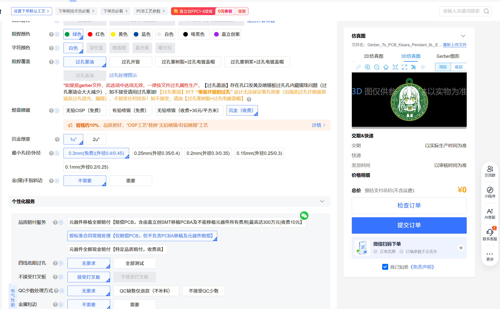
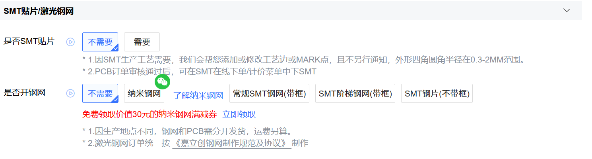

# 木更沉金 PCB 艺术通行证

## 如何打板

[⬇️ 下载 4 层 Gerber 文件](build/Kisara_Pendant_4L_ENIG.zip)

1. 下载上面的 zip，解压，得到 10 个文件。
2. 打开嘉立创 EDA 专业版。（搜“嘉立创eda”，点“在线使用”）（或者注册完，点“嘉立创EDA编辑器”，进入“专业版”）
3. 文件 → 导入 → Gerber，选解压出来的 10 个文件，层数填 4。
   菜单里没有 Gerber 导入的话，去“扩展 → 配置”，把 G2PCB 的“显示在顶部菜单”和“允许外部交互”都勾上，重开 EDA、双击打开 PCB1 再试。
4. 双击 PCB1，点“视图 → 3D 预览”，可以先看看板子颜色，再点 PCB1 回来。
5. 回到首页点“个人中心”，在左侧「优惠券中心 → PCB免费券」里领券。

点 PCB 免费券，答题后领取沉金券。**一定不要领错**：要选「2~4 层沉金 EDA 专用券」，不是别的层数，也不是 6 层那张。领错了这单用不了券。

找不到入口的话直接搜“嘉立创”，进优惠券中心。下面是券列表的样子：

6. 回到 EDA 界面，选中文件，点右上角蓝色的“PCB 下单”。如果跳出来让你重新选文件，就是没弄对。

推荐参数：FR-4、4 层、尺寸直接填好了不用管，不需要确认生产稿，1.6 mm、绿阻焊、白色普通丝印、沉金 1U"、5 片、单片出货、无阻抗。

层压顺序选“指定层压顺序”，四行填：`L1 GTL / L2 G1 / L3 G2 / L4 GBL`。

SMT 贴片、钢网都选“不需要”，其余保持默认。

那个“加嘉立创客编”，自己找个小角落放下，字体粗细往小了选，我是扔在背面那个最底下，打出来几乎看不到。

PS: 如果下单助手显示非嘉立创 EDA 文件，更新下单助手即可正常下单。
可以用券但又要付款，短时间内下单的人太多，系统认为是拆单，等第二天再打印吧。

## 版权说明

本项目为基于《契约之吻》的个人兴趣向同人 PCB 艺术板。

项目中涉及的《契约之吻》作品名称、角色“木更”、角色形象、Logo、世界观设定及其他原作相关视觉元素，其著作权及相关权利归原作者及相应版权方所有。

本人仅对自行完成的 PCB 板框设计、版式编排、图层处理、工程文件整理及其他原创设计部分主张相应权利。本仓库所采用的开源协议仅适用于本人有权授权的原创内容，不代表本人取得或向他人授予第三方角色形象、作品名称、Logo 或其他受保护素材的使用授权。

本项目主要用于个人收藏、PCB 设计交流与非商业兴趣分享。
