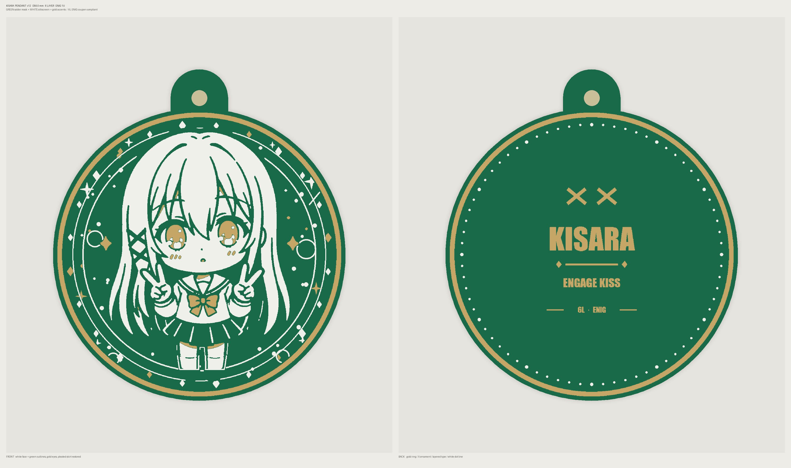

# 木更沉金 PCB 挂件 · 制作过程

《契约之吻》木更（Kisara）主题的双面 PCB 钥匙挂件。本仓库公开的是 **4 层沉金版**：层数少于已投产的 6 层版，可用「2~4 层沉金 EDA 专用券」下单且**无需晒图**；丝印、阻焊开窗、板框、钻孔与 6 层版逐字节一致，成品图案效果完全相同。

本项目为非盈利的个人工艺练习，角色形象权利归原作者及版权方。

## 1. 成品规格

| 项目 | 参数 |
|---|---|
| 成品尺寸 | 46.0 × 52.16 mm（Φ46 圆 + 同心挂耳） |
| 层数 | 4（顶 / 内层1 / 内层2 / 底，内层均有真实铜图形） |
| 板厚 / 板材 | 1.6 mm / FR-4 常规 |
| 阻焊 / 字符 | 绿色 / 白色 |
| 表面处理 | 沉金 ENIG 1U" |
| 挂孔 | Φ3.0 mm，NPTH，孔与挂耳同心 |
| 沉金面积 | 18.4%，低于免费打样 20% 上限 |
| 最小丝印线宽 | 0.164 mm（Gerber 回读，@64 ppm） |



## 2. 设计目标

角色辨识优先于构图：Q 版二头身全身、可爱惊讶脸（小圆嘴微张、腮红，不是坏笑）、超大圆眼中放入酒红花瓣瞳仁与白高光、画面左侧 X 形交叉发饰、粉白长直发加偏斜刘海、双手比 V、白色水手领与领结、百褶裙、短袜鞋。

挂件形态是圆形加挂耳，不是徽章式构图。人物放大到占板径约 90%，剩余空隙用同心圆弧、菱形串、四角星、气泡环和散点填满。背面按「补完成度，不补密度」处理：保留金环，加一圈细点线、`KISARA`、一对 X 发饰、`ENGAGE KISS` 和极小工艺落款。

参考图的使用边界要分清：怪盗基德 PCB 只参考高还原度和颜色分布，不照搬徽章构图；吧唧商品图只看排版；牧濑红莉栖图只看配色。把这些素材直接当作描摹对象会让成品失去角色辨识。

## 3. 图像生成与三色版画稿

输入两张参考：角色官方脸截图与 Q 版全身构图。用图生图（image-to-image，`input_fidelity=high`）得到保留官方面部特征的 Q 版全身像，再要求输出**纯白 / 纯黑 / 品红 #FF00FF 三色版画稿**，品红标记要做成金的点睛区域（瞳仁、领结、发饰、装饰环）。

得到版画稿后按颜色直接分区，不做泛洪、不自动找眼睛——早期自动找眼睛把脸部误判成瞳孔。RGB 亮度计算必须用 `int32`，`255*1000` 在 `int16` 下溢出会让白色整片判黑。

## 4. 位图分区法

这是唯一走通的技术路线。黑帽变换、骨架细化、折线拟合等矢量化描线方案全部失败过，原因是发丝和裙褶的分叉会断裂。

核心步骤：

1. 三色图按颜色分区，得到白区、黑区、品红区三个掩膜
2. `char_solid_mask()` 求人物实体：在边界做泛洪，取非背景连通域
3. 装饰先画完整圆或整条链，再用 `grow(char_solid, 2px)` 裁掉压到人物的部分，形成「装饰被人物遮挡」的层次
4. `E.rings` 取轮廓环 → `LA.rdp` 简化 → `grb.emit_rings` 输出 Gerber region（`G36/G37`）

线宽测量不能靠 `MaxFilter/MinFilter`（方核），要用 `distance_transform` 的脊线配合圆盘形态学 `morph.grow`。Gerber 回读面积随 ppm 升高而收敛，差异是光栅化量化误差，不是轮廓丢失。

## 5. 工艺映射：绿油白字沉金

白丝印块面负责脸、水手服和袜子，绿色阻焊留白充当勾线，这样保住「白脸木更」；金区由阻焊开窗表达，镀出来是金色。阻焊层在 Gerber 中是负片语义，画上图元等于不盖绿油，与 `GTS/GBS` 的「有图形即开窗」一致，**不需要取反**。

发丝之间会留下 2 px 窄白缝，用圆盘开运算（`morph.shrink/grow`）清掉，白丝印 P5 从 0.109 mm 提到 0.219 mm，不达标比例从 12.7% 降到 0。

**裙子消失的教训**：绿油白字方案会吃掉原稿的纯黑块面——黑块不印，与绿底融成一片；块内白色细褶线又被开运算删光，结果只剩两条白袜悬空。修法是从原稿下半身取白色细节（褶线、裙摆边），排除背景大连通域后加粗补回 `GTO`；鞋只描下半圈白边，绝不填白，否则袜子和鞋连成白柱。换任何工艺配色后都要逐部件核对角色，只看线宽和面积会漏掉这种问题。

## 6. 从 6 层改到 4 层

嘉立创 FR-4 只做 1 / 2 / 4 / 6 层，**不做 3 层**，官方答复（q1i50492）是把三层加一个空白层按四层制作。因此这里直接用 4 层，且 4 层正好属于「2~4 层沉金 EDA 专用券」适用范围：该券只要求满足订单工艺与 EDA 设计血统，**没有晒单要求**（t7i37587、37595）；与之相对，6 层两类券才写「晒单要求」。

改动只发生在内层铜：6 层版的 `GTL / G1~G4 / GBL` 换成 4 层的 `GTL / G1 / G2 / GBL`，内层沿用原来两个有真实图形的铜层，不用空白假层。

以下六层与 6 层版逐字节一致，因此成品外观完全不变：

```
GTS / GBS   阻焊开窗，决定沉金区域
GTO / GBO   白丝印，决定人物与文字
GKO         板框（Φ46 圆 + 挂耳）
TXT         钻孔（Φ3.0 NPTH 挂孔）
```

顶底层铜也原样保留，保证沉金开窗下方有铜可镀。4 层板不强制盘中孔工艺，下单页的阻焊覆盖保持默认即可（本板没有过孔，只有机械挂孔）。生成脚本见 `scripts/make_4layer.py`，运行后会自动校验外观层字节一致、内层铜非空、钻孔孔径与打包完整性。

## 7. Gerber 与自检

10 个文件：`GTL / G1 / G2 / GBL / GTS / GBS / GTO / GBO / GKO / TXT`，RS-274X，单位毫米，`FSLAX46Y46`。

交付前自检项：

- 外观六层与已投产版本 MD5 逐个相同
- 内层铜绘图指令数分别为 237 与 317 条，不是空层
- 沉金面积 18.4%，丝印不压金面
- 白丝印 P5 线宽达标
- 挂孔圆盘范围内所有层的图形像素为 0，孔不碰铜、开窗、丝印和板框线
- 打包 `testzip` 通过

## 8. 下单参数

对应券种：**2~4 层沉金 EDA 专用券**（免晒图）。

4 层 · 1.6 mm · FR-4 常规 · 绿色阻焊 · 白色字符 · 沉金 1U" · 5 片 · 单片出货 · 无阻抗 · 小助手或移动端下单 · 文件需由嘉立创 EDA 设计。

层压顺序选「指定层压顺序」：`L1 GTL / L2 G1 / L3 G2 / L4 GBL`。下单页「板子尺寸」由 GKO 自动解析，只改数字不会改变实物尺寸，还会触发工程确认。板材选项保持第一行常规档，不要选 TG155 / TG170 等加价项。

EDA 血统一条脚本解决不了：必须在嘉立创 EDA 内导入 Gerber 后另存为原生工程，再从工程下单。用第三方工具转换后直接上传不能算 EDA 设计。

## 9. 复现与文件

环境：Python 3，`numpy`、`Pillow`。脚本在 `scripts/`，主要链路为 `design8.py`（三色分区与板框）→ `design9.py`（排版）→ `design12.py`（绿油白字）→ `make_release12.py` → `final12.py`；尺寸缩放用 `scale13.py` 与 `final14.py`，4 层版用 `make_4layer.py`。原始线稿与参考图因涉及第三方素材未纳入仓库，已有 Gerber 与 zip 不依赖这些素材可直接下单。

```
build/Kisara_Pendant_4L_ENIG.zip       4 层最终生产包（10 文件）
build/gerber4L/                         4 层源文件
build/Kisara_Pendant_6L_ENIG_v14_HOLE3.zip  6 层原版，已投产
build/gerber14/                         6 层源文件
build/README_v14.md                    6 层版完整核对表
assets/size_final_v14.png               三版尺寸对比
```

## 10. 授权

脚本代码可自由参考与修改。角色形象、官方设定图、周边商品图及本仓库效果图不在授权范围内，不得商用或声称对其拥有权利。
